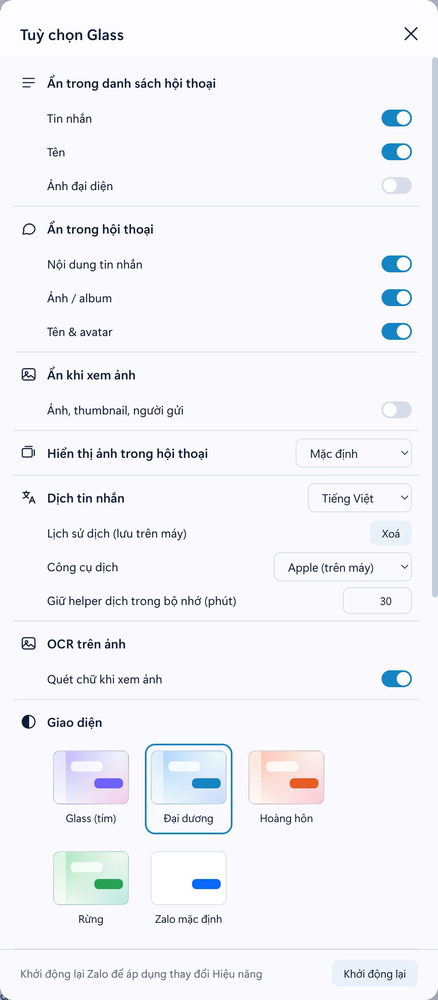
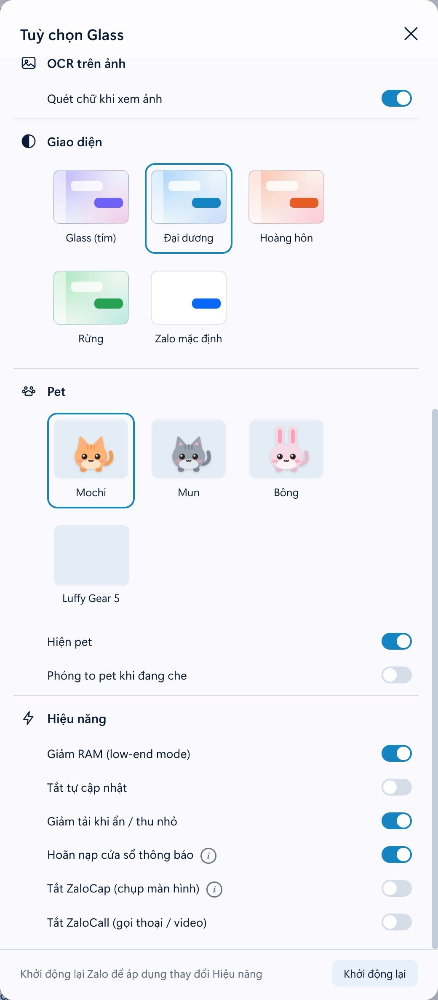

<div align="center">

# Lucent

Giao diện kính mờ (glassmorphism) cho Zalo PC trên macOS, Windows và Linux.


</div>

## Giới thiệu

Lucent thay giao diện mặc định của Zalo PC bằng nền kính mờ, có bốn theme và hai chế độ sáng/tối. Ngoài giao diện, Lucent bổ sung một số tiện ích còn thiếu trong Zalo: che nội dung khi cần, chọn chữ trên ảnh (OCR), xem album theo dải ngang, phím tắt và giảm mức dùng tài nguyên.

Lucent không cần cài thêm phần mềm nào và không có phụ thuộc. Trình cài đặt chèn CSS/JS vào `app.asar` của Zalo, giống cách ZaDark làm, đồng thời sao lưu bản gốc để khôi phục khi cần.

## Tính năng

- **Theme:** Glass (tím), Đại dương, Hoàng hôn, Rừng. Mỗi theme có bản sáng và tối, đổi ngay không cần khởi động lại.
- **Che nội dung:** ẩn tin nhắn, tên, ảnh đại diện, ảnh và album theo từng nhóm.
- **OCR trên ảnh:** chọn và sao chép chữ trong trình xem ảnh.
- **Album cuộn ngang:** hiển thị ảnh gửi theo nhóm thành một dải ngang.
- **Tạo cuộc họp Google Meet** từ menu của thanh công cụ chat.
- **Phím tắt** để chuyển hội thoại và thao tác với tin nhắn bằng bàn phím.
- **Tuỳ chọn hiệu năng:** giảm RAM, tắt tự cập nhật, giảm tải khi cửa sổ bị ẩn.
- **Pet:** ba nhân vật nhỏ ở góc màn hình, có nhiều trạng thái, có thể tắt.

### Theme

Chọn theme bằng nút con mắt ở thanh bên. Màu sắc của mọi theme đều đi qua các biến `--zg-*`, nên thêm theme mới chỉ cần khai báo một bảng màu (xem [docs/add-theme.md](docs/add-theme.md)).

<p align="center"></p>

### Che nội dung

Có thể bật riêng từng phần:

| Khu vực | Có thể ẩn |
|---|---|
| Danh sách hội thoại | Tin nhắn, tên, ảnh đại diện |
| Khung chat | Nội dung tin nhắn, ảnh và album, sticker, danh thiếp, mã QR, vị trí, tin OA, dòng hệ thống, tin ghim, tên và số thành viên, avatar |
| Trình xem ảnh | Ảnh, ảnh thu nhỏ, người gửi |

Phần bị ẩn hiện lại khi rê chuột vào. Khi đang che, pet có thể tự phóng to (tuỳ chọn).

<p align="center"></p>

### Bảng tuỳ chọn

Nút con mắt ở thanh bên mở bảng tuỳ chọn gồm phần che nội dung, theme, pet và hiệu năng. Thiết lập được lưu theo từng máy.

<table>
<tr>
<td width="50%" valign="top"></td>
<td width="50%" valign="top"></td>
</tr>
</table>

### Pet

Có ba nhân vật: Mochi, Mun và Bông. Pet tự đi dạo trong vùng chat, nói vài câu ngẫu nhiên và đổi trạng thái theo cách bạn tương tác:

| Trạng thái | Khi nào |
|---|---|
| Vui | Rê chuột vào pet |
| Ngủ | Sau 60 giây không thao tác |
| Nổi giận | Bấm liên tục 5 lần |
| Diễn trò (chích điện, súng nước, thở oxy, khóc, ngất) | Ngẫu nhiên, hoặc khi bấm vào pet |

<p align="center"></p>

Pet có thể tắt trong bảng tuỳ chọn. Thêm pet mới: [docs/add-pet.md](docs/add-pet.md).

#### Luffy Gear 5

Pet **Luffy Gear 5** là fan art SVG chibi với tóc trắng xoăn, vòng mây quanh vai, đai tím và dép. Chọn nút con mắt → "Pet" → "Luffy Gear 5"; pet có lời thoại tiếng Việt riêng và dùng các hành vi đi bộ, nhảy, vui, ngủ, khóc và hết pin có sẵn. Nếu đã cài Lucent, chạy lại script cài đặt từ bản mã nguồn có pet này rồi mở lại Zalo để thấy lựa chọn mới.

Luffy **tự đổi ngẫu nhiên sang một Gear khác mỗi 10 giây**, không cần giữ Shift: dạng thường (gọi Gear 1 cho tiện, mũ rơm và áo đỏ), Gear 2 (da ửng hồng, hơi nước), Gear 3 (tay khổng lồ), Gear 4 Boundman (thân bơm hơi, tóc dựng, Haki đen viền đỏ) hoặc Gear 5 (tóc trắng, vòng mây). Nếu đến hạn khi cửa sổ không có focus, pet bị ẩn, đang ngủ hoặc bận tung chiêu thì chờ tới khi hoạt động lại rồi đổi một lần; lượt tiếp theo tính sau đó 10 giây. Dạng Gear chỉ giữ trong phiên hiện tại; đổi pet rồi chọn lại hoặc mở lại Zalo sẽ về Gear 5, không đổi khoá lưu lựa chọn pet.

**Click thường vào Luffy để tung chiêu theo Gear hiện tại**: Pistol, Jet Gatling, Gigant Pistol, Kong Gun hoặc đòn cao su tự do Gear 5. Click sẽ thay thế gag khóc/hết pin đang diễn bằng chiêu; click dồn khi đang tung chiêu không khởi động lại hay chồng lượt. Chiêu kéo dài khoảng 2 giây, kèm lời thoại rồi trở lại bình thường. Luffy cũng có thể tự diễn gag khi rảnh; các pet khác giữ phản ứng click gốc.

**Shift + click Luffy** để đổi ngay sang một Gear khác ngẫu nhiên, kể cả khi đang tung chiêu. Mỗi lần đổi chủ động cũng bắt đầu lại mốc tự đổi 10 giây.

Đi bộ, nhảy, ngủ và lời thoại giữ cơ chế pet gốc: nghỉ 6–18 giây rồi chọn đi tới một vị trí ngẫu nhiên trong vùng (45%), nhảy (10%), diễn gag (25%) hoặc đứng yên (20%). Pet chỉ bắt đầu hành vi khi cửa sổ Zalo đang được dùng, không ngủ, không bận và không nói. Ngoài click, pet vẫn có thoại chào, thoại khi gõ, lúc ngủ/thức và 50% cơ hội nói mỗi 90 giây như bản gốc. **Đổi Gear không tự bật thoại và không ngắt bước đi.**

Tuỳ chọn giảm chuyển động của hệ điều hành tắt nhún và vung chiêu. Không có animation mới chạy khi đứng yên. Cài lại Lucent rồi mở lại Zalo để nạp bản mới.

Các dáng được vẽ lại thành SVG chibi, tham khảo [tư liệu Gear 4 trên ONE PIECE.com](https://one-piece.com/usop/o20160127_0511/index.html) và [mô hình Gear 5 của Bandai](https://gashapon.jp/products/detail.html?jan_code=4570118247285000); không tải ảnh hay gọi mạng khi pet chạy.

Các màn tung chiêu là bản diễn hoạt chibi tham khảo [Jet Gatling của Bandai](https://www.bandai.co.jp/candy/products/2010/625830.html), [Gigant Pistol](https://one-piece.com/anime/555/index.html) và [Kong Gun](https://one-piece.com/figure/o4617/index.html); đòn cao su Gear 5 là gag sáng tạo cho pet.

### Google Meet

Menu `…` trên thanh công cụ chat có thêm mục **Tạo cuộc họp Google Meet**. Mục này mở `meet.google.com/new` bằng trình duyệt mặc định.

<p align="center"></p>

### OCR trên ảnh

Trình xem ảnh tự nhận dạng chữ khi mở ảnh. Chữ được phủ lên đúng vị trí trên ảnh, có thể bôi đen và sao chép bằng `⌘C` / `Ctrl+C`, hoặc bấm **Sao chép tất cả** để lấy toàn bộ. Nút `Aa` trên thanh công cụ (hoặc phím `T`) bật/tắt tính năng này. macOS dùng Vision, Windows dùng `ocr.ps1`, Linux dùng `tesseract`.

<p align="center"></p>

### Album, phím tắt

| Tính năng | Cách dùng |
|---|---|
| Album | Ảnh gửi theo nhóm hiển thị thành một dải ngang giữ nguyên tỉ lệ, có nút `‹` `›` và chỉ số `k/N`. Cuộn bằng trackpad hoặc `Shift` + lăn chuột. Bật trong bảng tuỳ chọn. |
| Chuyển hội thoại | `Esc` quay về danh sách. `↑` / `↓` đổi hội thoại, `Enter` mở lại. |
| Duyệt tin nhắn | Trong ô soạn trống, `↑` vào chế độ duyệt. `↑` / `↓` (hoặc `k` / `j`) đổi tin, `R` trả lời, `F` chuyển tiếp, `E` thả cảm xúc (`1`–`6`, `7` để gỡ), `Esc` thoát. |

### Hiệu năng

Các tuỳ chọn sau áp dụng khi khởi động lại Zalo: giảm RAM (low-end mode), tắt tự cập nhật, giảm tải khi ẩn hoặc thu nhỏ, hoãn nạp cửa sổ thông báo. Lucent cũng luôn tắt bộ đo FPS của Zalo vì nó giữ GPU hoạt động liên tục.

## Cài đặt

Yêu cầu: đã cài Zalo PC. Node.js không bắt buộc, nếu máy không có thì script dùng Electron của Zalo.

Trình cài đặt sẽ đóng Zalo, sao lưu bản gốc vào `~/.zalo-glass-backup/<phiên bản>`, vá `app.asar` rồi mở lại Zalo.

**macOS / Linux**

```bash
git clone https://github.com/nhthai173/lucent.git
cd lucent
./install.sh
```

**Windows**

```powershell
git clone https://github.com/nhthai173/lucent.git
cd lucent
powershell -ExecutionPolicy Bypass -File install.ps1
```

Sau khi cài, bấm nút con mắt ở thanh bên để chọn theme và các tuỳ chọn.

Khi Zalo tự cập nhật, bản vá bị ghi đè. Chạy lại script cài đặt để áp dụng lại.

### Gỡ cài đặt

```bash
./uninstall.sh
```

```powershell
powershell -ExecutionPolicy Bypass -File uninstall.ps1
```

### Biến môi trường

| Biến | Ý nghĩa |
|---|---|
| `ZALO_APP` | Thư mục cài Zalo, nếu không nằm ở vị trí mặc định. |
| `GLASS_JS` | Danh sách module JS được nạp. Mặc định `"blur album keys ocr pet meet"`. Bỏ một tên khỏi danh sách để tắt tính năng tương ứng. Module `templates` luôn được nạp trước. |
| `GLASS_TRANSPARENT=1` | Cửa sổ trong suốt. Chỉ macOS, thử nghiệm. |

Ví dụ, chỉ cài theme và tính năng che nội dung:

```bash
GLASS_JS="blur" ./install.sh
```

## Cách hoạt động

`install.mjs` ghép các file trong [theme/](theme) thành một gói CSS và một gói JS, ghi chúng vào `app.asar`, rồi chèn thẻ `<link>` và `<script>` vào các trang của Zalo. Trên macOS, script cập nhật `Info.plist` và ký lại ứng dụng. CSS ghi đè các biến màu của Zalo, JS thêm các thành phần giao diện (nút con mắt, pet, lớp OCR, …). Phần chạy trong tiến trình chính của Electron (tuỳ chọn hiệu năng, máy chủ OCR cục bộ) được chèn vào đầu `bootstrap.js`.

Chi tiết xem [docs/architecture.md](docs/architecture.md).

## Đóng góp

| Việc cần làm | Tài liệu |
|---|---|
| Thêm hoặc sửa theme | [docs/add-theme.md](docs/add-theme.md) |
| Thêm pet, sửa lời thoại và hoạt cảnh | [docs/add-pet.md](docs/add-pet.md), [docs/pet-quotes.md](docs/pet-quotes.md), [docs/pet-animation.md](docs/pet-animation.md) |
| Thêm module hoặc mục menu | [docs/add-module.md](docs/add-module.md) |
| Chạy thử và kiểm tra thay đổi | [docs/build-and-verify.md](docs/build-and-verify.md) |
| Hiệu năng (animation, timer, `backdrop-filter`) | [docs/performance.md](docs/performance.md) |

Commit theo [Conventional Commits](https://www.conventionalcommits.org/) (`feat:`, `fix:`, `docs:`, …) với tiêu đề tiếng Anh ngắn gọn. Pull request thay đổi giao diện nên kèm ảnh chụp, và cần che tên, avatar thật.

## Lưu ý

- Đã kiểm tra trên macOS và Windows. Đường dẫn cài Zalo trên Linux chưa được kiểm chứng, nếu không tìm thấy thì đặt `ZALO_APP`.
- OCR trên macOS cần Xcode Command Line Tools để biên dịch `ocr.swift`. OCR trên Linux cần `tesseract` và `tesseract-ocr-vie`.
- Bản cập nhật của Zalo có thể đổi tên class và làm lệch một số selector. Khi gặp lỗi, hãy mở issue kèm phiên bản Zalo và ảnh chụp.
- Lucent là dự án cộng đồng, không liên quan tới VNG hay Zalo. Chỉnh sửa ứng dụng của bên thứ ba luôn có rủi ro, hãy cân nhắc trước khi dùng. Bản gốc được lưu trong `~/.zalo-glass-backup/`.

## Giấy phép

[MIT](LICENSE)
