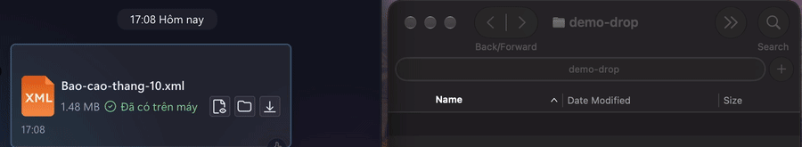
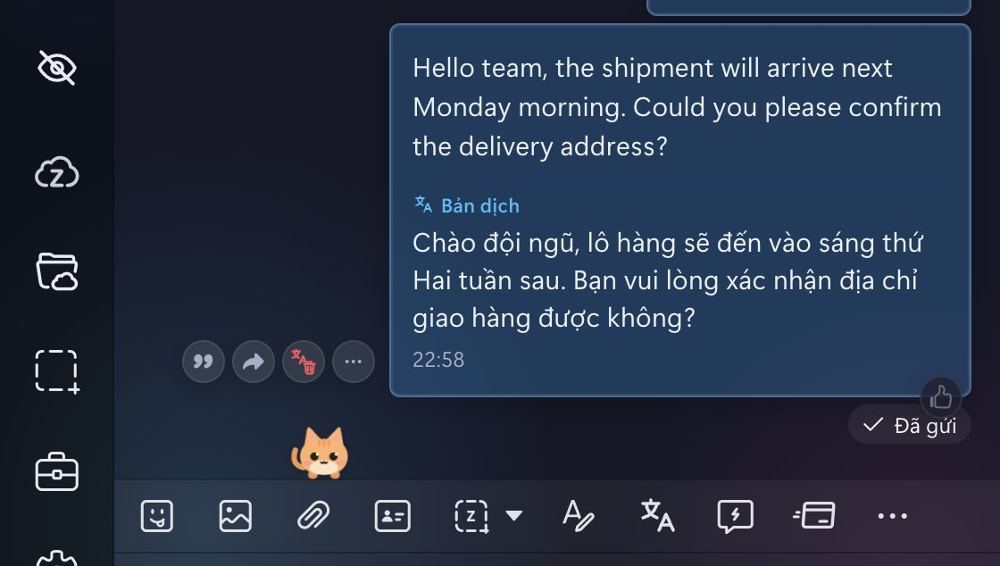
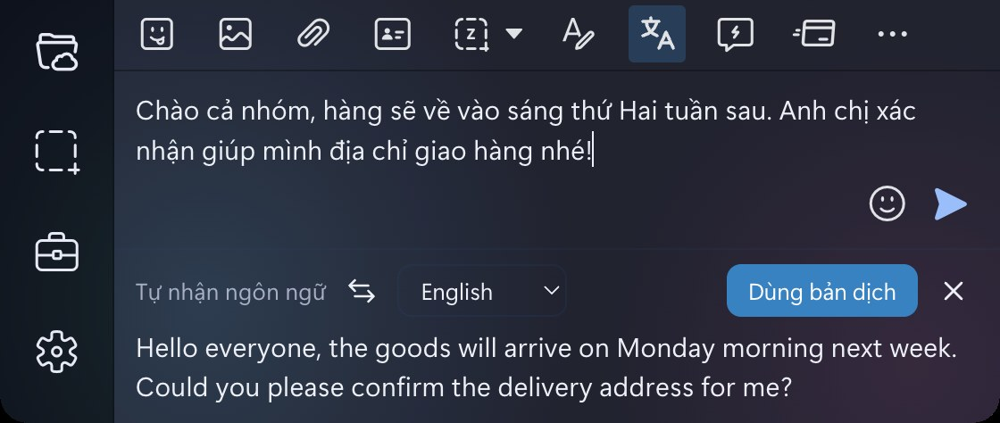

<div align="center">

# Lucent

Giao diện kính mờ (glassmorphism) cho Zalo PC trên macOS, Windows và Linux.


</div>

## Giới thiệu

Lucent thay giao diện mặc định của Zalo PC bằng nền kính mờ, có bốn theme và hai chế độ sáng/tối. Ngoài giao diện, Lucent bổ sung một số tiện ích còn thiếu trong Zalo: che nội dung khi cần, chọn chữ trên ảnh (OCR), dịch tin nhắn, kéo file ra ngoài, xem album theo dải ngang, phím tắt và giảm mức dùng tài nguyên.

Lucent không có phụ thuộc nào. Trình cài đặt chèn CSS/JS vào `app.asar` của Zalo (giống cách ZaDark làm) và sao lưu bản gốc để khôi phục khi cần. Riêng OCR và dịch trên macOS cần Xcode Command Line Tools để biên dịch helper lúc cài.

## Tính năng

- **Theme:** Glass (tím), Đại dương, Hoàng hôn, Rừng, hoặc giao diện gốc của Zalo. Mỗi theme có bản sáng và tối, đổi ngay không cần khởi động lại.
- **Che nội dung:** ẩn tin nhắn, tên, ảnh đại diện, ảnh và album theo từng nhóm.
- **OCR trên ảnh:** chọn và sao chép chữ trong trình xem ảnh.
- **Dịch tin nhắn:** dịch tin nhận và tin đang soạn ngay trong Zalo. Chạy trên máy với macOS, hoặc qua Google.
- **Kéo file ra ngoài:** kéo thẻ file trong chat thả thẳng vào Finder hoặc Explorer.
- **Album cuộn ngang:** hiển thị ảnh gửi theo nhóm thành một dải ngang.
- **Tạo cuộc họp Google Meet** từ menu của thanh công cụ chat.
- **Phím tắt** để chuyển hội thoại và thao tác với tin nhắn bằng bàn phím.
- **Tuỳ chọn hiệu năng:** giảm RAM, tắt tự cập nhật, giảm tải khi cửa sổ bị ẩn, tắt chụp màn hình và gọi điện của Zalo nếu không dùng.
- **Pet:** bốn nhân vật nhỏ ở góc màn hình, có nhiều trạng thái, có thể tắt.

### Theme

Chọn theme bằng nút con mắt ở thanh bên. Chọn "Zalo mặc định" để tắt hẳn lớp phủ kính và dùng giao diện gốc của Zalo (các tiện ích như pet, OCR, dịch vẫn chạy). Màu sắc của mọi theme đều đi qua các biến `--zg-*`, nên thêm theme mới chỉ cần khai báo một bảng màu (xem [docs/add-theme.md](docs/add-theme.md)).

<p align="center"></p>

### Che nội dung

Có thể bật riêng từng phần:

| Khu vực | Có thể ẩn |
|---|---|
| Danh sách hội thoại | Tin nhắn, tên, ảnh đại diện |
| Khung chat | Nội dung tin nhắn, ảnh và album, sticker, danh thiếp, mã QR, vị trí, tin OA, dòng hệ thống, tin ghim, tên và số thành viên, avatar |
| Trình xem ảnh | Ảnh, ảnh thu nhỏ, người gửi |

Phần bị ẩn hiện lại khi rê chuột vào khung chat. Khi đang che, pet có thể tự phóng to (tuỳ chọn).

<p align="center"></p>

### Bảng tuỳ chọn

Nút con mắt ở thanh bên mở bảng tuỳ chọn: che nội dung, kiểu hiển thị ảnh trong hội thoại, dịch tin nhắn, OCR, theme, pet và hiệu năng. Phần hiệu năng áp dụng khi mở lại Zalo, các phần còn lại đổi ngay. Thiết lập được lưu theo từng máy.

<table>
<tr>
<td width="50%" valign="top"></td>
<td width="50%" valign="top"></td>
</tr>
</table>

### Pet

Có bốn nhân vật: Mochi, Mun, Bông và Luffy Gear 5. Pet tự đi dạo trong vùng chat, nói vài câu ngẫu nhiên và đổi trạng thái theo cách bạn tương tác:

| Trạng thái | Khi nào |
|---|---|
| Vui | Rê chuột vào pet |
| Ngủ | Sau 60 giây không thao tác |
| Nổi giận | Bấm 5 lần trong 4 giây |
| Diễn trò (chích điện, súng nước, thở oxy, khóc, ngất) | Ngẫu nhiên, hoặc khi bấm vào pet |

<p align="center"></p>

Pet có thể tắt trong bảng tuỳ chọn. Thêm pet mới: [docs/add-pet.md](docs/add-pet.md).

#### Luffy Gear 5

Pet thứ tư, vẽ lại dạng chibi bằng SVG, có lời thoại tiếng Việt riêng. Chọn ở nút con mắt → "Pet" → "Luffy Gear 5".

- **Đổi Gear:** khi Zalo đang được dùng, cứ 10 giây pet tự đổi giữa dạng thường (Gear 1), Gear 2, Gear 3, Gear 4 (Boundman) và Gear 5. `Shift` + click để đổi ngay. Dạng Gear chỉ giữ trong phiên, mở lại Zalo sẽ về Gear 5.
- **Tung chiêu:** click vào pet để tung chiêu theo Gear hiện tại (Pistol, Jet Gatling, Gigant Pistol, Kong Gun hoặc đòn Gear 5). Mỗi chiêu kéo dài khoảng 2 giây, kèm một câu thoại.
- Đi bộ, nhảy, ngủ và thoại dùng chung cơ chế với các pet khác. Pet tôn trọng tuỳ chọn giảm chuyển động của hệ điều hành, và đứng yên thì không chạy animation.

Hình vẽ tham khảo tư liệu [Gear 4 trên ONE PIECE.com](https://one-piece.com/usop/o20160127_0511/index.html) và [mô hình Gear 5 của Bandai](https://gashapon.jp/products/detail.html?jan_code=4570118247285000). Các chiêu tham khảo [Jet Gatling](https://www.bandai.co.jp/candy/products/2010/625830.html), [Gigant Pistol](https://one-piece.com/anime/555/index.html) và [Kong Gun](https://one-piece.com/figure/o4617/index.html); đòn Gear 5 là phần sáng tạo thêm. Pet không tải ảnh hay gọi mạng khi chạy.

### Google Meet

Menu `…` trên thanh công cụ chat có thêm mục **Tạo cuộc họp Google Meet**. Mục này mở `meet.google.com/new` bằng trình duyệt mặc định.

<p align="center"></p>

### Kéo file ra thư mục

Kéo thẻ file trong chat thả thẳng vào Finder hoặc Explorer, thay cho nút **Lưu về máy** rồi chọn thư mục. Tên file giữ nguyên như trong chat.

<p align="center"></p>

- Chỉ kéo được file đã có trên máy (thẻ hiện "Đã có trên máy") trong tin do người khác gửi. File do chính bạn gửi chưa kéo được.

### OCR trên ảnh

Trình xem ảnh tự nhận dạng chữ khi mở ảnh. Chữ nằm đúng vị trí trên ảnh, bôi đen và sao chép bằng `⌘C` / `Ctrl+C`, hoặc bấm **Sao chép tất cả**. Nút quét chữ trên thanh công cụ (biểu tượng chữ A trong khung ngắm) hoặc phím `T` bật/tắt quét cho ảnh đang xem. Tắt hẳn trong bảng tuỳ chọn, mục "OCR trên ảnh".

Engine theo hệ điều hành: macOS dùng Vision, Windows dùng `ocr.ps1` (Windows.Media.Ocr), Linux dùng `tesseract`.

<p align="center"></p>

### Dịch tin nhắn

Dịch tin nhắn ngay trong Zalo, bản dịch hiện dưới chữ gốc. Mặc định tắt; bật ở nút con mắt → "Dịch tin nhắn", chọn Tiếng Việt hoặc English.

<p align="center"></p>

- Rê chuột vào tin chữ rồi bấm nút dịch cùng hàng với Trả lời / Chia sẻ, hoặc chuột phải chọn "Dịch tin nhắn". Bấm "Gỡ bản dịch" để ẩn và xoá bản dịch đã lưu.
- Tin reply chỉ dịch phần chữ, không dịch phần trích dẫn. Xuống dòng được giữ nguyên.
- Bản dịch được lưu trong `~/.zalo-glass/translations/` nên mở lại chat vẫn còn. Nút "Xoá" ở mục này xoá toàn bộ lịch sử dịch (có hỏi xác nhận).
- Bản dịch bị che cùng với "Nội dung tin nhắn" trong phần Ẩn trong hội thoại.

Hai công cụ dịch:

| Công cụ | Chạy ở đâu | Ghi chú |
|---|---|---|
| Apple (trên máy) | macOS 26 trở lên | Không gửi nội dung ra ngoài. Mặc định trên macOS. Cần tải trước gói ngôn ngữ trong Cài đặt hệ thống > Ngôn ngữ & vùng > Ngôn ngữ dịch. |
| Google (online) | Mọi hệ điều hành | Cách duy nhất trên Windows và Linux. Nội dung tin nhắn được gửi tới Google nên chỉ dùng khi bạn chủ động bật. Dùng endpoint không chính thức, có thể bị giới hạn tốc độ hoặc ngừng hoạt động. |

Trên Windows và Linux, công cụ là Google ngay khi bật dịch. Trên macOS đổi sang Google ở mục "Công cụ dịch".

Với công cụ Apple, một tiến trình nền giữ model đã nạp nên lần dịch đầu mất khoảng 3 giây, các lần sau khoảng 0,5 giây. Tiến trình này dùng khoảng 20 MB RAM và gần như không tốn CPU khi nhàn rỗi. Mặc định nó tự thoát sau 30 phút không dịch; chỉnh số phút trong bảng tuỳ chọn (0 là thoát ngay sau mỗi lần).

### Dịch khi soạn tin

Dịch trực tiếp lúc bạn gõ, kiểu Google Translate. Nút dịch nằm ngay sau nút định dạng chữ (Aa) trên thanh công cụ của ô soạn, hiện khi đã bật "Dịch tin nhắn". Ô soạn của Zalo vẫn là ngôn ngữ gốc, bản dịch cập nhật ngay bên dưới.

<p align="center"></p>

- Bản dịch cập nhật khoảng 0,5 giây sau lần gõ cuối. Ngôn ngữ gốc tự nhận, ngôn ngữ đích chọn ở ô chọn, nút ⇄ đảo giữa Tiếng Việt và English.
- @mention và emoji không đi qua bản dịch mà được ghép lại nguyên vẹn.
- Bấm "Dùng bản dịch" để thay nội dung ô soạn bằng bản dịch, rồi gửi như thường bằng Enter. Tin nhiều dòng được dịch và đặt lại từng dòng. Nếu bản dịch đổi thứ tự mention hoặc emoji thì nội dung được dán gộp thành một dòng và mention thành chữ thường.
- Bản nháp không được lưu vào lịch sử dịch. Nội dung đang soạn và bản dịch đều bị che như tin nhắn khi bật chế độ che nội dung.

### Album, phím tắt

| Tính năng | Cách dùng |
|---|---|
| Album | Ảnh gửi theo nhóm hiển thị thành một dải ngang giữ nguyên tỉ lệ, có nút `‹` `›` và chỉ số `k/N`. Cuộn bằng trackpad hoặc `Shift` + lăn chuột. Bật trong bảng tuỳ chọn. |
| Chuyển hội thoại | `Esc` quay về danh sách. `↑` / `↓` đổi hội thoại, `Enter` mở lại. |
| Duyệt tin nhắn | Trong ô soạn trống, `↑` vào chế độ duyệt. `↑` / `↓` (hoặc `k` / `j`) đổi tin, `R` trả lời, `F` chuyển tiếp, `E` thả cảm xúc (`1`–`6`, `7` để gỡ), `Esc` thoát. |

### Hiệu năng

Các tuỳ chọn này nằm trong bảng tuỳ chọn, lưu ở `~/.zalo-glass/config.json` và chỉ áp dụng sau khi mở lại Zalo (nút **Khởi động lại** ở cuối bảng):

| Tuỳ chọn | Tác dụng |
|---|---|
| Giảm RAM | Giới hạn bộ nhớ của renderer và số luồng vẽ. |
| Tắt tự cập nhật | Zalo không tự kiểm tra bản mới. |
| Giảm tải khi ẩn / thu nhỏ | Cửa sổ ẩn hoặc thu nhỏ chạy chậm lại. |
| Hoãn nạp cửa sổ thông báo | Cửa sổ thông báo riêng của Zalo (Windows, Linux) chỉ nạp khi cần, nên thông báo đầu tiên có thể trễ hoặc trống. Không nên bật trên Windows và Linux; macOS dùng thông báo hệ thống nên gần như không ảnh hưởng. |
| Tắt ZaloCap | Bỏ chụp màn hình của Zalo. Zalo cũng không dán được ảnh hoặc file từ clipboard. |
| Tắt ZaloCall | Bỏ gọi thoại và video. |

Lucent luôn tắt bộ đo FPS của Zalo vì nó giữ GPU hoạt động liên tục.

## Cài đặt

Yêu cầu: đã cài Zalo PC. Node.js không bắt buộc, nếu máy không có thì script dùng Electron của Zalo.

Trình cài đặt sẽ đóng Zalo, sao lưu bản gốc vào `~/.zalo-glass-backup/<phiên bản>`, vá `app.asar` rồi mở lại Zalo.

**macOS / Linux**

```bash
git clone https://github.com/nhthai173/lucent.git
cd lucent
./install.sh
```

**Windows**

```powershell
git clone https://github.com/nhthai173/lucent.git
cd lucent
powershell -ExecutionPolicy Bypass -File install.ps1
```

Sau khi cài, bấm nút con mắt ở thanh bên để chọn theme và các tuỳ chọn.

Khi Zalo tự cập nhật, bản vá bị ghi đè. Chạy lại script cài đặt để áp dụng lại.

### Gỡ cài đặt

```bash
./uninstall.sh
```

```powershell
powershell -ExecutionPolicy Bypass -File uninstall.ps1
```

### Biến môi trường

| Biến | Ý nghĩa |
|---|---|
| `ZALO_APP` | Thư mục cài Zalo, nếu không nằm ở vị trí mặc định. |
| `GLASS_JS` | Danh sách module JS được nạp. Mặc định `"blur album keys ocr pet meet drag translate live"`. Bỏ một tên khỏi danh sách để tắt tính năng tương ứng. Module `templates` luôn được nạp trước. |
| `GLASS_TRANSPARENT=1` | Cửa sổ trong suốt. Chỉ macOS, thử nghiệm. |

Ví dụ, chỉ cài theme và tính năng che nội dung:

```bash
GLASS_JS="blur" ./install.sh
```

## Cách hoạt động

`install.mjs` ghép các file trong [theme/](theme) thành một gói CSS và một gói JS, ghi chúng vào `app.asar`, rồi chèn thẻ `<link>` và `<script>` vào các trang của Zalo. Trên macOS, script cập nhật `Info.plist` và ký lại ứng dụng. CSS ghi đè các biến màu của Zalo, JS thêm các thành phần giao diện (nút con mắt, pet, lớp OCR, …). Phần chạy trong tiến trình chính của Electron (tuỳ chọn hiệu năng, helper dịch, máy chủ cục bộ cho OCR, cấu hình và kéo file) được chèn vào đầu `bootstrap.js`. Máy chủ này chỉ nghe ở `127.0.0.1`.

Chi tiết xem [docs/architecture.md](docs/architecture.md).

## Đóng góp

| Việc cần làm | Tài liệu |
|---|---|
| Thêm hoặc sửa theme | [docs/add-theme.md](docs/add-theme.md) |
| Thêm pet, sửa lời thoại và hoạt cảnh | [docs/add-pet.md](docs/add-pet.md), [docs/pet-quotes.md](docs/pet-quotes.md), [docs/pet-animation.md](docs/pet-animation.md) |
| Thêm module hoặc mục menu | [docs/add-module.md](docs/add-module.md) |
| Chạy thử và kiểm tra thay đổi | [docs/build-and-verify.md](docs/build-and-verify.md) |
| Hiệu năng (animation, timer, `backdrop-filter`) | [docs/performance.md](docs/performance.md) |

Commit theo [Conventional Commits](https://www.conventionalcommits.org/) (`feat:`, `fix:`, `docs:`, …) với tiêu đề tiếng Anh ngắn gọn. Pull request thay đổi giao diện nên kèm ảnh chụp, và cần che tên, avatar thật.

## Lưu ý

- Đã kiểm tra trên macOS và Windows. Đường dẫn cài Zalo trên Linux chưa được kiểm chứng, nếu không tìm thấy thì đặt `ZALO_APP`.
- OCR và dịch trên macOS cần Xcode Command Line Tools để biên dịch `ocr.swift`, `translate.swift`. OCR trên Linux cần `tesseract` và `tesseract-ocr-vie`.
- Bản cập nhật của Zalo có thể đổi tên class và làm lệch một số selector. Khi gặp lỗi, hãy mở issue kèm phiên bản Zalo và ảnh chụp.
- Lucent là dự án cộng đồng, không liên quan tới VNG hay Zalo. Chỉnh sửa ứng dụng của bên thứ ba luôn có rủi ro, hãy cân nhắc trước khi dùng. Bản gốc được lưu trong `~/.zalo-glass-backup/`.

## Giấy phép

[MIT](LICENSE)
